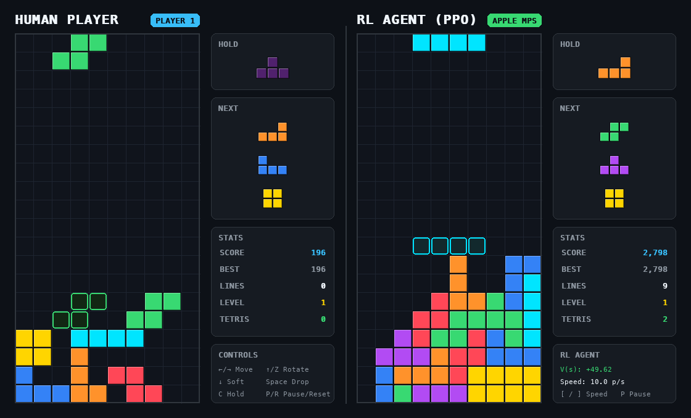
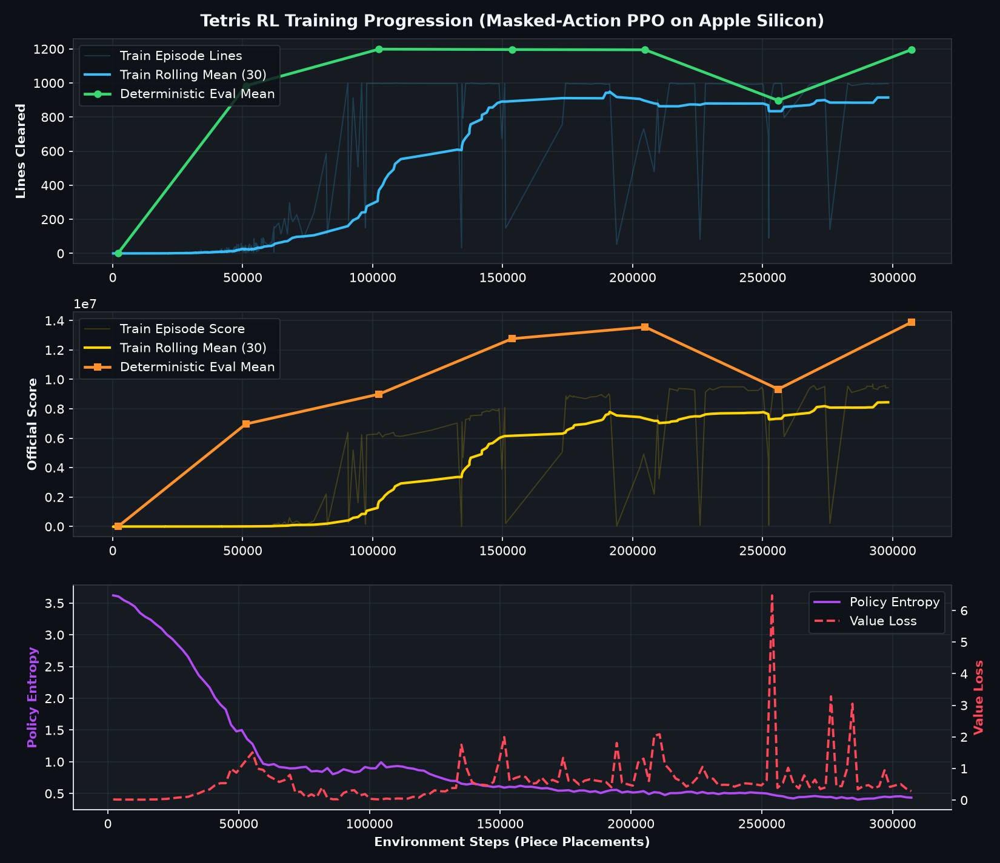

# Tetris RL — Human-Playable Guideline Tetris & Apple Silicon PPO Agent

A complete **`uv`** Python project featuring:
1. **Human-Playable Guideline Tetris**: 60 FPS Pygame-CE interface with 7-bag randomizer, SRS rotation & wall kicks, hold queue, 3-piece next preview, ghost piece, DAS/ARR input handling, combos, and Guideline scoring.
2. **Apple Silicon (`MPS`) Reinforcement Learning Agent**: A Dual-Stream 2D CNN + Structural MLP Actor-Critic trained with Masked-Action PPO over reachable piece placements (`hold` + rotation + column).
3. **Watch & Versus Modes**: Watch the trained RL agent play live (with animated piece steps and real-time value estimates `V(s)`) or challenge it side-by-side in Split-Screen Versus mode.



---

## Benchmark Results (`Apple M2 Pro` — `mps`)

Evaluated deterministically across **20 seeded episodes** (`max_pieces = 5,000` per episode) on `checkpoints/best_model.pt` (`update = 150`, `307,200` piece placements):

| Metric | Mean | Median | Min | Max |
| :--- | ---: | ---: | ---: | ---: |
| **Lines Cleared** | **1,925.6** | **1,995.5** | 1,148 | 1,999 |
| **Official Score** | **36,143,120** | **38,426,721** | — | 38,678,028 |
| **Pieces Placed** | **4,828.2** | — | — | 5,000 |
| **Tetris Rate (4-line clears)** | **83.4%** | — | — | — |



---

## Quickstart (`uv`)

Requires [`uv`](https://docs.astral.sh/uv/) on macOS (Apple Silicon `MPS` or CPU). Python `3.12` is pinned via `.python-version`.

```bash
# 1. Install locked dependencies into .venv
uv sync

# 2. Play Tetris yourself
uv run tetris-play

# 3. Watch the trained RL agent play
uv run tetris-play --ai

# 4. Play Split-Screen Human vs. RL Agent
uv run tetris-play --versus

# 5. Evaluate the trained checkpoint across 20 seeded episodes
uv run tetris-eval --episodes 20 --checkpoint checkpoints/best_model.pt

# 6. Train a fresh RL model from scratch on Apple Silicon MPS
uv run tetris-train --updates 150 --num-envs 16

# 7. Run the full test suite
uv run pytest -v
```

*(You can also invoke `uv run play.py`, `uv run train.py`, and `uv run evaluate.py` directly.)*

---

## Controls

| Key | Action |
| :--- | :--- |
| `←` / `→` or `A` / `D` | Move left / right (with `150ms` DAS, `40ms` ARR) |
| `↑` / `W` / `X` | Rotate clockwise |
| `Z` | Rotate counter-clockwise |
| `↓` or `S` | Soft drop (`+1` pt/row) |
| `Space` | Hard drop (`+2` pts/row) |
| `C` or `Shift` | Hold / swap active piece |
| `[` / `]` or `-` / `+` | Decrease / increase AI speed (`--ai` / `--versus` modes) |
| `P` | Pause / resume |
| `R` | Restart game |
| `Esc` | Quit |

---

## RL Architecture & Training Design

- **Afterstate Placement Space (`MAX_CANDIDATES = 72`)**: Instead of issuing dozens of low-level frame actions per piece, each decision step enumerates all physically reachable placements `(use_hold, rotation, target_x)` for the active and hold pieces.
- **Dual-Stream Network (`TetrisActorCritic`)**:
  - **Spatial 2D CNN Stream**: `Conv2d(1→16) → SiLU → Conv2d(16→32) → SiLU → Linear(480→64) + LayerNorm` over each candidate `(20, 10)` post-drop occupancy grid.
  - **Structural MLP Stream**: `Linear(12→64) + LayerNorm + SiLU` over 12 vectorized NumPy board heuristics (`lines_cleared`, `is_tetris`, `holes`, `covered_weight`, `bumpiness`, `sum_height`, `max_height`, `height_span`, `row_transitions`, `col_transitions`, `well_sums`, `landing_height`).
  - **Actor & Critic Heads**: Fused `128`-dim candidate embeddings produce masked policy logits `(B, 72)` and a permutation-invariant `max + mean` pooled state value `V(s)`.
- **Masked-Action PPO + Potential Shaping**: Trained with `GAE(λ=0.95)`, `γ=0.99`, potential-based reward shaping `γΦ(s') − Φ(s)`, and value bootstrapping on piece-cap truncation.

---

## Project Layout

```text
├── pyproject.toml          # uv project config & CLI entrypoints
├── uv.lock                 # Locked dependency graph
├── .python-version         # Pinned Python 3.12
├── play.py                 # Human / AI Watch / Versus Pygame CLI
├── train.py                # PPO training entrypoint (Apple MPS / CPU)
├── evaluate.py             # Deterministic multi-episode benchmark CLI
├── checkpoints/
│   └── best_model.pt       # Trained PPO checkpoint (378 KB)
├── assets/
│   ├── gameplay_preview.png
│   └── training_curve.png
├── tetris/
│   ├── pieces.py           # SRS shapes, color palette, 7-bag generator
│   ├── engine.py           # Core Tetris engine & placement enumeration
│   ├── ui_pygame.py        # 60 FPS Pygame-CE renderer & AI controller
│   └── rl/
│       ├── features.py     # Vectorized NumPy features & potential shaping
│       ├── env.py          # Single & vectorized Tetris RL environments
│       ├── network.py      # Dual-Stream CNN + MLP Actor-Critic
│       └── ppo.py          # Masked-Action PPO trainer & plotter
└── tests/
    ├── test_engine.py      # Human Tetris engine & headless UI tests
    └── test_rl.py          # RL feature, env, network & PPO smoke tests
```
